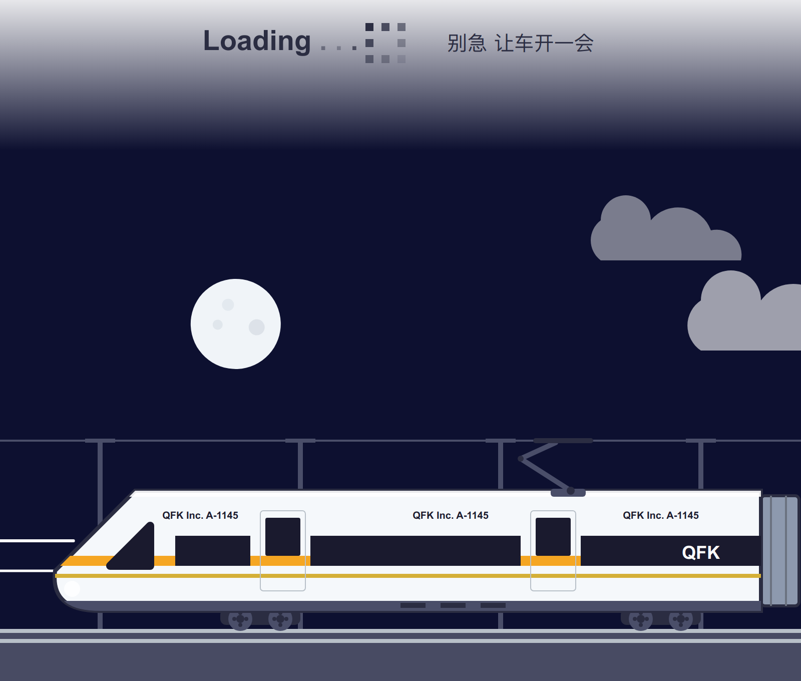

# 高铁 Loading · Animated SVG Loading Screen

纯 SVG 动画加载页：一列「QFK Inc. A-1145」高铁停在站台，接触网飞驰、车轮旋转，
背景在 20 秒里走完一轮 **白天 → 日落 → 星空 → 日出**。零 JavaScript、零依赖，
整个动画就是一个 `.svg` 文件。



## 特点

- **100% SVG + SMIL**：18 个 `<animate>`、12 个 `<animateTransform>`，没有 JS、没有外部图片和字体。
- **完整昼夜循环**：天空、太阳/月亮、星星、云朵各自按 `keyTimes` 同步变化，周期 20s。
- **高铁细节**：受电弓与接触网对齐、车轮逆时针转动、车门、QFK 涂装、车厢编号。
- **Loading 元素**：像素方块指示器 + 「Loading ...」+「别急 让车开一会」。
- **矢量**：任意缩放不糊，文件仅 16 KB。

## 使用

```html

```

也可以：

```html
<object data="train-loading.svg" type="image/svg+xml" width="800" height="680"></object>
```

本地预览：

```bash
python3 -m http.server 8099
# 打开 http://127.0.0.1:8099/
```

或直接双击 `index.html`。

## 文件

| 文件 | 说明 |
| --- | --- |
| `train-loading.svg` | 动画本体（单文件，可直接嵌入） |
| `preview.png` | 夜间帧截图（2x，1600×1360） |
| `index.html` | 本地全屏预览页 |

## 兼容性

动画使用 SMIL（`<animate>` / `<animateTransform>`），Chrome、Firefox、Safari 均支持。
用 `` 或 CSS `background` 引用时动画通常仍会播放；但部分图片代理 / 渲染器
（例如某些 Markdown 预览服务）会把它静态化成第一帧。

## 许可证

**WTFPL — Do What The Fuck You Want To Public License, Version 2**，完整条文见 [LICENSE](./LICENSE)。

你想怎么用就怎么用：复制、修改、商用、闭源、去掉 QFK 标志、再授权都行，不需要署名，
也不提供任何担保。
